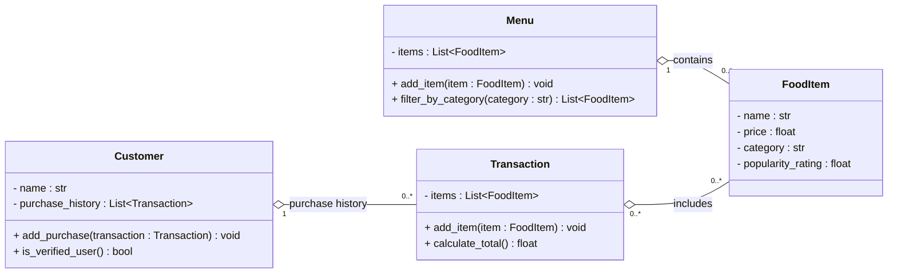

# ByteBites Class Diagram

## Design Decisions

Each element of the design maps to a requirement in `bytebites_spec.md`.

| Class | Element | Spec requirement it covers |
|---|---|---|
| Customer | `name`, `purchase_history` | "tracking their names and their past purchase history" |
| Customer | `add_purchase()` | Adds a completed transaction to the history |
| Customer | `is_verified_user()` | "so the system can verify they are real users" (see A1) |
| FoodItem | `name`, `price`, `category`, `popularity_rating` | "name, price, category, and popularity rating" |
| Menu | `items`, `add_item()` | "a digital list that holds all items" |
| Menu | `filter_by_category()` | "filter by category such as 'Drinks' or 'Desserts'" |
| Transaction | `items`, `add_item()` | "group them into a single transaction… store the selected items" |
| Transaction | `calculate_total()` | "compute the total cost" |

## Relationships

| Relationship | Type | Meaning |
|---|---|---|
| Customer → Transaction | Aggregation (1 to 0..*) | The customer's purchase history. A new customer starts with zero transactions. |
| Menu → FoodItem | Aggregation (1 to 0..*) | The menu holds the full collection of items. Items can exist independently of the menu. |
| Transaction → FoodItem | Aggregation (0..* to 0..*) | A transaction refers to existing food items, and the same item can appear in many transactions. |

## Removed From the Previous Draft

These elements went beyond the client request and were removed to keep the design within scope:

- `categories : List[str]` and `has_category()`. The spec says "category", singular, so this became `category : str`.
- `Menu.search_by_name()` and `Menu.remove_item()`. The spec only asks for holding items and filtering by category.
- `Transaction.order_id`, `order_date`, `payment_method`, and `remove_item()`. None of these are in the spec.
- The `Transaction.customer` back-reference. The customer already holds its transactions through `purchase_history`, so the reverse link isn't needed.
- `Dict[FoodItem, int]` for quantities. A plain list is used instead: buying two of an item means adding it twice, which still gives the correct total.

## Assumptions

| # | Class | Element | Assumption |
|---|---|---|---|
| A1 | Customer | `is_verified_user()` | Returns `True` if the customer has at least one completed purchase in `purchase_history`. It shows that the customer is a returning purchaser. It is **not** identity authentication, and it **does not stop new customers from placing orders**. This is a design interpretation, because the spec doesn't define what "verify they are real users" means. |
| A2 | Customer | `add_purchase()` | Called only after a transaction is completed, so `purchase_history` holds only real purchases. |
| A3 | Menu | `add_item()` | Kept because the menu needs some way to be filled with items. |
| A4 | FoodItem | `price`, `popularity_rating` | Stored as `float` to keep the project beginner-friendly. |
| A5 | Transaction | `calculate_total()` | The total is never stored. It is calculated from the current items each time the method is called, so it can't go out of date. |
