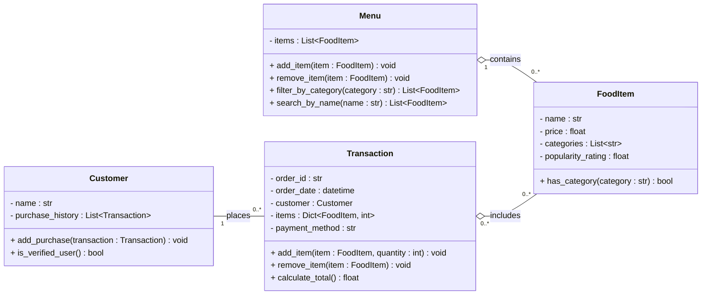

# ByteBites Class Diagram

## Relationships

| Relationship | Type | Meaning |
|---|---|---|
| Menu → FoodItem | Aggregation (1 to 0..*) | The menu holds the full collection of food items. Items can exist independently of the menu. |
| Transaction → FoodItem | Aggregation (0..* to 0..*) | A transaction groups the selected items. It can be empty while the customer is still choosing, and one item can appear in many transactions. A completed order needs at least one item, but checkout enforces that rule, not the multiplicity (see A12). |
| Customer — Transaction | Association (1 to 0..*) | Each transaction belongs to exactly one customer. A customer can have zero transactions, so new customers are allowed. Only completed transactions are added to `purchase_history` (see A13). |

## Assumptions (beyond the client spec, for review)

| # | Class | Element | What the spec says | Assumption |
|---|---|---|---|---|
| A1 | FoodItem | `categories : List[str]` | Each item has "category" (singular). | An item can belong to several categories, e.g. "Drinks" and "Specials". `has_category()` is a helper for this. |
| A2 | Menu | `search_by_name()` | Only filtering by category is required. | Customers can also search for items by name. |
| A3 | Menu | `add_item()` / `remove_item()` | "Manage the full collection." | Managing the collection means adding and removing items. |
| A4 | Transaction | `items : Dict[FoodItem, int]` | "Store the selected items." | Quantities are tracked, so `calculate_total()` returns the sum of price × quantity. A dict stands in for a separate `OrderLine` class. |
| A5 | Transaction | `remove_item()` | Not mentioned. | A customer can remove an item before checkout. |
| A6 | Transaction | `order_id`, `order_date` | Not mentioned. | Each transaction gets an ID and a date. |
| A7 | Transaction | `customer` | Not mentioned directly. | Each transaction links back to its customer. Purchase history implies the link, but the back-reference is a design choice. |
| A8 | Transaction | `payment_method` | Not mentioned. | Payment information is stored as a simple string, with no `Payment` class. |
| A9 | Customer | `purchase_history : List[Transaction]` | "Past purchase history." | The history is stored as `Transaction` objects, not as a list of `FoodItem`s. |
| A10 | Customer | `is_verified_user()` | "Track purchase history so the system can verify they are real users." | `is_verified_user()` returns true if the customer has at least one previously completed purchase. This status identifies returning purchasers and **does not prevent new customers from placing orders**. A customer becomes verified after their first completed transaction. This is a design interpretation, not an explicit client requirement. |
| A11 | All | Types (`float` for price and rating) | Not specified. | Prices use `float` to keep things simple. A real system might use `Decimal`. |
| A12 | Transaction | Transaction → FoodItem multiplicity `0..*` | "Group them into a single transaction." | A transaction starts empty and is filled with `add_item()`. A completed order needs at least one item, and checkout checks this, not the class multiplicity. |
| A13 | Customer / Transaction | When `add_purchase()` is called | Not specified. | `add_purchase()` is called only when a transaction is completed. Open transactions are not part of `purchase_history`, so `is_verified_user()` counts only real purchases. |
| A14 | Transaction | No `total_price` attribute | "Compute the total cost." | The total is never stored. `calculate_total()` works it out from the current items and quantities each time, so it can't go stale. **Caveat:** `items` points to the live `FoodItem` objects, so a later price change would also change the totals of past transactions. If historical accuracy matters, the price should be saved at checkout. That is left out for now. |
